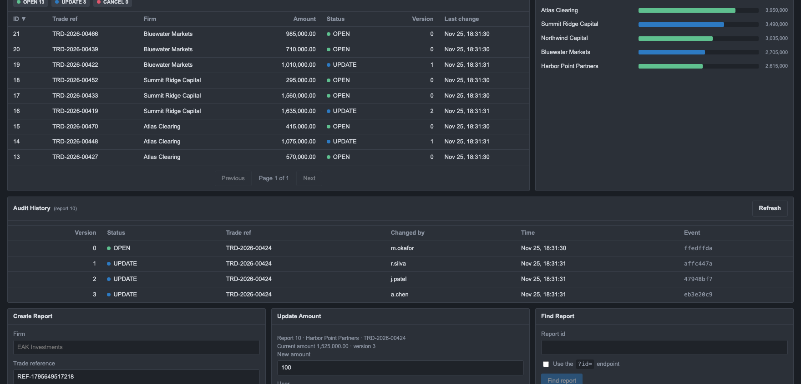
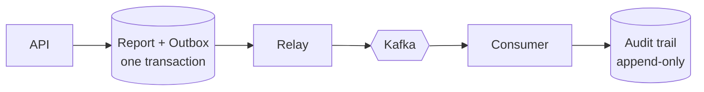
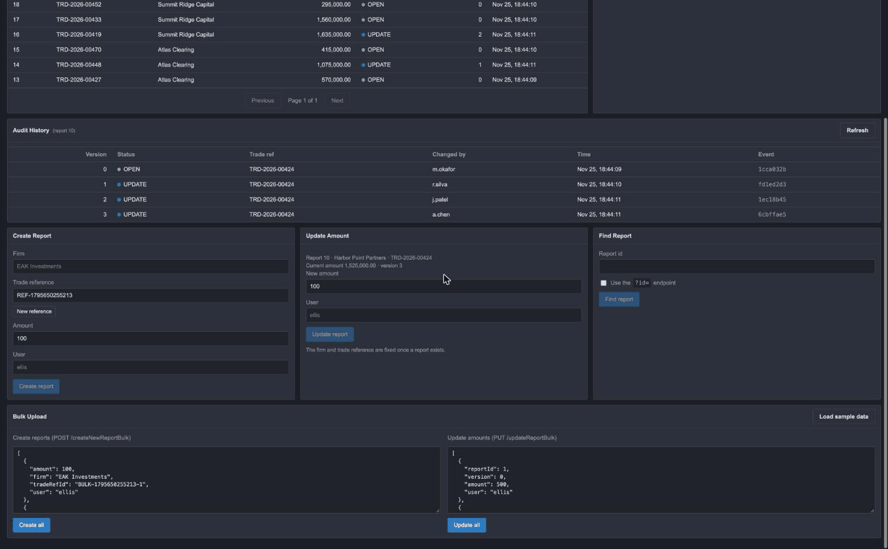
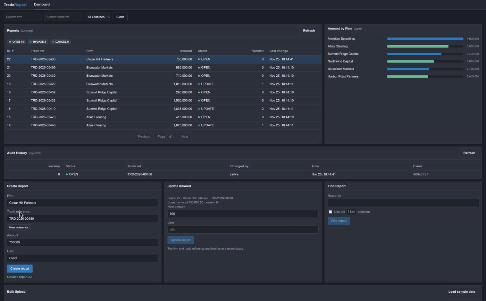
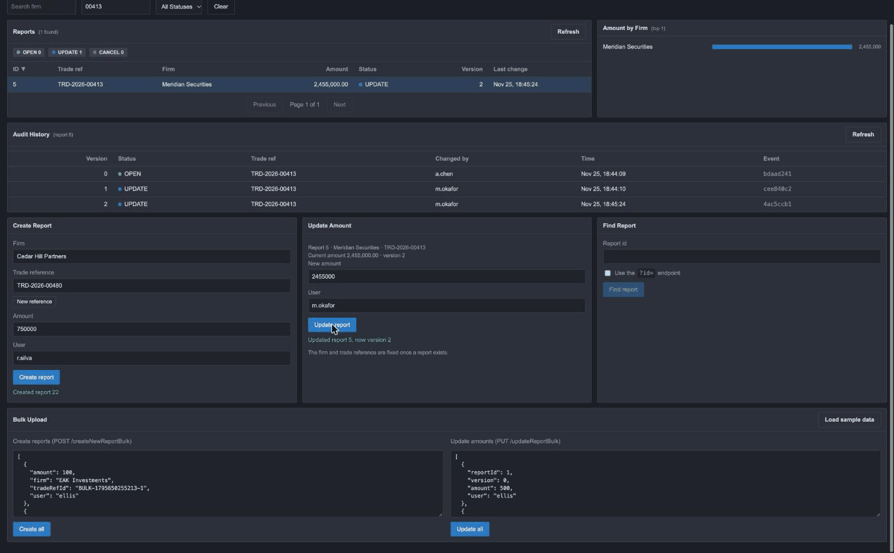
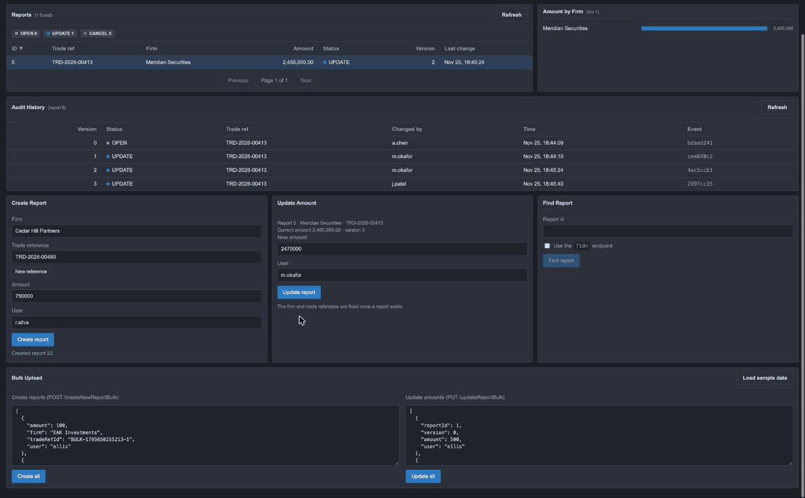

<p align="center">
  
</p>

<h1 align="center">TradeReport</h1>


<p align="center"><b>Every change. Recorded forever.</b></p>
<p align="center">
  A trade reporting service where nothing is lost, nothing is duplicated, and history can't be rewritten.
</p>

<br>

## Designed to be trusted

| | |
|---|---|
| **Nothing lost** <br> A change and its event are saved together, so a committed report always reaches the audit trail. | **Nothing doubled** <br> Creating the same report twice is refused. Redelivered events are absorbed. |
| **Nothing rewritten** <br> Audit rows are append-only. The database itself rejects edits and deletes. | **Nothing overwritten** <br> Updates carry the version you saw. If someone got there first, you're told. |
| **Built to scale** <br> Run as many instances as you like. They share the work without stepping on each other. | **Easy to see** <br> A dashboard shows every report, its history, and who changed it. |

<br>

## How it works



You change a report. The change and its event commit together. A relay publishes the event, and a consumer
writes one audit row for it. A repeat delivery is harmless.

<br>

## See it work

<table>
  <tr>
    <td align="center" width="50%"><br><b>Create a report</b><br>It appears in the table, and its history starts with one audit row.</td>
    <td align="center" width="50%"><br><b>Update a report</b><br>Search, select, change the amount. A new version and a new audit row.</td>
  </tr>
  <tr>
    <td align="center" width="50%"><br><b>A conflicting update</b><br>Someone else changed it first. You get a 409 and reload the latest version.</td>
    <td align="center" width="50%"><br><b>A duplicate create</b><br>The same firm and trade reference is refused, whatever the amount.</td>
  </tr>
</table>

<br>

## Get started

```bash
docker compose up -d postgres kafka
./mvnw spring-boot:run
```

Then open the dashboard at **http://localhost:4200** (see the `TradeReportClient` folder).

<br>

## The details that matter

- **Strict create.** One report per firm and trade reference. A repeat gets a clear 409.
- **Versioned updates.** A stale update is rejected, never silently applied.
- **Search, sort and paging** across every report, done in the database.
- **Clear errors.** Consistent RFC 7807 responses. No internals leak.
- **Real-database tests.** Postgres in Docker, with the real migrations.
- **Stress tested.** 1,000 identical requests at once produce exactly one report.

<br>

## Built with

Spring Boot, Java 21, PostgreSQL, Kafka, Flyway, Testcontainers, Angular, Docker.
Pull requests were reviewed by CodeRabbit, and each finding was checked against the code before acting on it.

<br>

## Go deeper

[Architecture decisions](docs/adr) · [Challenges faced](docs/challenges-faced.md) · [Stress test](scripts/stress-test)

<sub>Honest limits: no authentication yet (a deliberate choice, see Known limitations), and audits are eventually consistent by about a second.</sub>

---

# Technical guide

## Architecture

```
POST /createNewReport ─┐
PUT  /updateReport    ─┤   one DB transaction
                       ▼
        ┌──────────────────────────┐
        │ trade_report (the change)│
        │ outbox_event (the event) │
        └────────────┬─────────────┘
                     │ OutboxRelay (scheduled, every instance, SKIP LOCKED)
                     ▼
          Kafka topic: trade-report-events   (key = reportId, 12 partitions)
                     │ consumer group: trade-report-audit
                     ▼
          TradeReportConsumer ──► trade_reports_audits (unique event_id)
                     │ on repeated failure
                     ▼
          trade-report-events.DLT   (dead-letter topic)
```

| Piece | What it does |
|---|---|
| Outbox | The report change and its event commit together, so a committed change is never lost before reaching Kafka. |
| `OutboxRelay` | Publishes unpublished outbox rows to Kafka. Instances claim different rows (`FOR UPDATE SKIP LOCKED`). |
| `TradeReportConsumer` | Inserts one audit row per event. The unique `event_id` makes redelivery harmless (idempotent). |
| DLT | Messages that keep failing (or can't be deserialized) are parked on `trade-report-events.DLT` instead of blocking a partition. |
| DB trigger | `UPDATE` and `DELETE` on `trade_reports_audits` are rejected, so audits are immutable. |

### Trade-offs to know
- Audits are **eventually consistent**: a read right after a write may not show its audit yet.
- Delivery is **at-least-once**; duplicates are absorbed by the unique `event_id`.
- Events for one report can arrive slightly out of order if different instances relay them. Order audit history by `report_version`.
- Parallelism is capped by partition count (12 by default): at most 12 consumer threads do work at once across all instances.

## Prerequisites
- Java 21+ (tested on 21)
- Docker Desktop (running)
- No separate Maven install needed; use the included `./mvnw`

## Run it

All commands are from the project folder.

### 1. Start Postgres and Kafka
```bash
docker compose up -d postgres kafka
docker compose ps
```
Wait until both show `healthy`.

### 2. Start the app
```bash
./mvnw spring-boot:run
```
On startup, Flyway creates the tables and the app creates the Kafka topics.

### 3. Try it
```bash
curl -X POST localhost:8080/createNewReport \
  -H 'Content-Type: application/json' \
  -d '{"amount":10.50,"firm":"firmA","tradeRefId":"REF-1","user":"ellis"}'

curl -X PUT localhost:8080/updateReport \
  -H 'Content-Type: application/json' \
  -d '{"reportId":1,"version":0,"amount":99.99,"user":"bob"}'

curl localhost:8080/getReport/1
curl 'localhost:8080/getReports?page=0&size=10&sort=amount&dir=DESC&firm=acme'
curl localhost:8080/getReportSummary
curl localhost:8080/getReportAudits/1
```
A second or so later, each change has produced one row in `trade_reports_audits`, which `getReportAudits` returns.

`getReports` returns one page (`page` from 0, `size` default 50, at most 200). `sort` is one of `id`, `tradeRefId`, `firm`, `amount`, `version`, `lastChange` and `dir` is `ASC` or `DESC` (default: newest first). `firm`, `tradeRefId` and `status` filter across all reports; text matches anywhere, ignoring case. The response has `content`, `page`, `size`, `totalElements` and `totalPages`. `getReportSummary` takes the same filters and returns the count per status and the biggest firms by total amount. `getReportAudits/{id}` returns one
report's audit history, oldest version first, or a 404 if the report does not exist.

A web dashboard lives in the sibling `TradeReportClient` folder (Angular, runs in Docker on port 4200).
Browsers only let a page call this API if the API allows the page's origin (CORS). Allowed origins come from
`CORS_ALLOWED_ORIGINS`, default `http://localhost:4200`.

### 4. Run a second instance (scale-out demo)
In another terminal:
```bash
./mvnw spring-boot:run -Dspring-boot.run.arguments=--server.port=8081
```
Both instances join the `trade-report-audit` group and Kafka splits the 12 partitions between them
(look for `partitions assigned` in the logs, or check Kafka UI).

## Web UIs (optional)
```bash
docker compose --profile ui up -d
```

| Tool | URL | Notes |
|---|---|---|
| Kafka UI | http://localhost:8090 | Topics, messages, consumer group lag, DLT |
| pgAdmin | http://localhost:5050 | No login. Server "TradeReport (local)" is pre-registered; password is `tradereport` (tick Save Password). Right-click the `tradereport` database, then Query Tool. |

## Database access

| Setting | Value |
|---|---|
| Host / Port | `localhost` / `5432` |
| Database | `tradereport` |
| User / Password | `tradereport` / `tradereport` (local only) |

Port 5432 speaks the Postgres protocol, not HTTP, so a browser can't open it. Use pgAdmin, IntelliJ's Database tool, DBeaver, or psql:
```bash
docker exec -it tradereport-postgres-1 psql -U tradereport -d tradereport
```

Useful queries:
```sql
select * from trade_report;
select * from outbox_event order by id;                 -- published_at set = sent to Kafka
select * from trade_reports_audits order by id;         -- the audit trail
select count(*), count(distinct event_id) from trade_reports_audits;  -- should match
```

## Configuration

Set as environment variables (defaults in `application.properties`):

| Variable | Default | Purpose |
|---|---|---|
| `DB_URL` | `jdbc:postgresql://localhost:5432/tradereport` | Database |
| `DB_USER` / `DB_PASSWORD` | `tradereport` / `tradereport` | Database login |
| `KAFKA_BOOTSTRAP` | `localhost:9092` | Kafka brokers |
| `KAFKA_PARTITIONS` | `12` | Topic partitions (can only be increased) |
| `KAFKA_REPLICAS` | `1` | Use 3 in a real cluster |
| `CONSUMER_CONCURRENCY` | `3` | Consumer threads per instance |
| `CORS_ALLOWED_ORIGINS` | `http://localhost:4200` | Browser origins allowed to call the API (comma separated) |

Outbox relay: `app.outbox.relay.enabled`, `app.outbox.relay.poll-ms` (500), `app.outbox.relay.batch-size` (100).

## Tests
```bash
./mvnw test
```
**Docker must be running** (Docker Desktop or any Docker-compatible runtime) before you run the tests.
The database tests start a throwaway PostgreSQL container with Testcontainers, so the first run may take a
moment to pull the `postgres:16-alpine` image. No other setup is needed. The Kafka listener and the outbox
relay are switched off in tests, so no broker is required.

- Unit and controller tests use no database, or an in-memory H2 database where Flyway is off and the schema
  comes from the entities.
- Database tests run against real Postgres with the Flyway migrations. They check the unique constraints and
  the audit immutability trigger, which H2 cannot.
- Together they cover audit idempotency (a duplicate delivery creates one row), that creating a report writes
  an outbox row but no synchronous audit, and the controller's error handling (400, 404, 409, 500).

## Stopping and resetting
```bash
docker compose --profile ui down        # stop containers, keep data
docker compose --profile ui down -v     # stop and DELETE all data (Postgres, pgAdmin settings)
```

## Troubleshooting
- **`docker compose` says unknown command:** open Docker Desktop and wait for it to finish starting.
- **App can't connect to Postgres or Kafka:** run `docker compose ps` and check both are `healthy`.
- **Messages in `trade-report-events.DLT`:** inspect them in Kafka UI. Typical causes are messages from before `eventId` existed, or an event whose report row is missing.
- **Changed partition count on an existing topic:** this changes which partition each key maps to. Do it at a quiet time or use a new topic.

## Known limitations
- `cancelReport` in `TradeReportService` is incomplete (it saves nothing and isn't exposed by the controller).
- **Authentication and authorization are out of scope.** Anyone who can reach the API can call every endpoint,
  and the audit `user` is whatever the client sends, so the audit records who the client *claimed* to be, not who was
  authenticated. This was left out on purpose: the project is about the outbox, idempotent create and the append-only
  audit, and login would be a large separate piece. To add it: put Spring Security with JWT in front of the API, take
  `user` from the token instead of the request body, and use roles to decide who may create or update.
- Local credentials are for development only; use real secrets and a managed Postgres/Kafka elsewhere.
